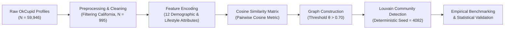
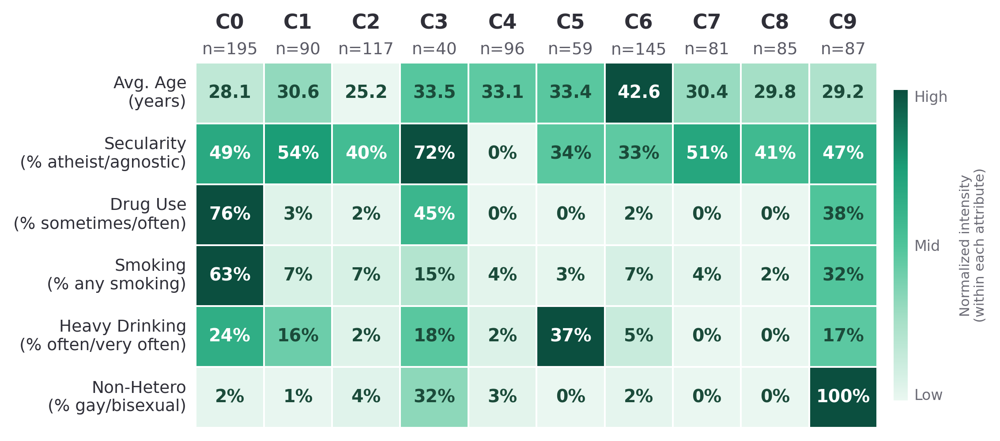

<div align="center">

# Toward Personalized Dating Recommendations: Graph-Based Community Detection Using Louvain and Cosine Similarity on OkCupid

[](paper/Toward_Personalized_Dating_Recommendations_ICITCOM2026.pdf)
[](https://www.python.org/)
[](LICENSE)
[](notebooks/okcupid_community_detection_louvain.ipynb)

**Aisya Mufidah Najwa**, **Amalia Nur Alifah**\*, **Tarisma Dwi Putri Alifianti**, **Ikfan Putra Maesru Dwi Pradana**

*Department of Data Science, Faculty of Informatics, Telkom University Surabaya, Indonesia*  
*\*Corresponding Author: amalialifah@telkomuniversity.ac.id*

---

</div>

## 📌 Overview

The rapid growth of digitalization has transformed social interaction through online dating platforms, creating complex underlying social structures that are not directly observable. Standard collaborative filtering techniques often struggle in dating environments due to the extreme sparsity of interaction logs, privacy constraints, and the cold-start problem.

This repository hosts the official implementation, empirical evaluation, and reproducibility pipeline for our paper:
> **"Toward Personalized Dating Recommendations: Graph-Based Community Detection Using Louvain and Cosine Similarity on OkCupid"**  
> *Accepted at the International Conference on Information Technology and Communication (ICITCOM) 2026.*

We propose an unsupervised Social Network Analysis (SNA) framework that couples high-dimensional attribute encoding with **Cosine Similarity-based graph modeling** and the **Louvain modularity optimization algorithm**. By enforcing a deterministic random seed (`random_state=4082`), our framework constructs a robust 10-community partition across $N = 995$ California users, achieving high modularity ($Q = 0.6861$) and statistically significant attribute alignment.

---

## 🔬 Methodology Workflow



1. **Preprocessing & Filtering**: Extract California users ($N = 995$) with complete records across 12 salient demographic, lifestyle, and behavioral attributes.
2. **Feature Standardization**: Categorical variables are standardized and one-hot/label-encoded; numerical attributes (e.g., age) are normalized.
3. **Similarity Graph Construction**: Pairwise Cosine Similarity is evaluated across all user attribute vectors. An undirected, weighted graph $G = (V, E)$ is instantiated where edges exist if and only if $\text{Cosine Similarity}(u, v) > 0.70$.
4. **Deterministic Partitioning**: The Louvain algorithm optimizes modularity ($Q$) with a fixed seed (`random_state=4082`), deterministically producing 10 stable communities.
5. **Validation Proxies**: In the absence of explicit interaction logs (likes/swipes), community quality is evaluated via topological metrics, threshold sensitivity analysis, algorithm benchmarking, Chi-square independence tests, and attribute hold-out experiments.

---

## 📊 Key Findings & Experimental Results

### 1. Topological Network Statistics
The constructed similarity network ($\theta = 0.70$) forms a cohesive graph with no isolated nodes in its largest component:

| Metric | Value | Description |
|---|---|---|
| **Nodes ($|V|$)** | `995` | Filtered user profiles |
| **Edges ($|E|$)** | `14,896` | Weighted pairwise connections ($\theta > 0.7$) |
| **Network Density** | `0.0301` | Sparse, clustered structure |
| **Avg. Clustering Coefficient** | `0.4889` | Strong local cohesion |
| **Avg. Path Length (LCC)** | `3.7171` | Short path length across Largest Connected Component |
| **LCC Size** | `995 (100%)` | Single fully connected component |
| **Number of Communities** | `10` | Discovered lifestyle clusters |
| **Modularity ($Q$)** | `0.6861` | High community partition quality ($Q > 0.3$ indicates strong structure) |

*Full data available in [`results/network_statistics.csv`](results/network_statistics.csv).*

---

### 2. Community Detection Algorithm Comparison
To empirically justify the choice of Louvain, we benchmarked 5 prominent community detection algorithms on the identical similarity graph ($G$, $\theta = 0.70$):

| Algorithm | Communities Detected | Modularity ($Q$) | Execution Time (s) |
|---|:---:|:---:|:---:|
| **Leiden** | 10 | **0.6892** | 0.030 |
| **Louvain** (Ours) | 10 | **0.6861** | 0.193 |
| **Label Propagation** | 16 | 0.6018 | 0.042 |
| **Greedy Modularity (CNM)** | 6 | 0.5934 | 1.217 |
| **Infomap** | 3 | 0.2673 | 0.066 |

*Louvain and Leiden achieve the highest modularity scores (~0.686–0.689) and produce 10 interpretable, balanced communities.*

*Full benchmark available in [`results/algorithm_comparison.csv`](results/algorithm_comparison.csv).*

---

### 3. Cosine Threshold Sensitivity ($\theta$)
Sweeping the threshold parameter $\theta \in [0.5, 0.9]$ demonstrates why $\theta = 0.7$ was chosen as optimal:

| Threshold ($\theta$) | Edges ($|E|$) | Density | Communities | Modularity ($Q$) | Isolated Nodes |
|:---:|:---:|:---:|:---:|:---:|:---:|
| **0.5** | 44,740 | 0.0905 | 9 | 0.5277 | 0 |
| **0.6** | 27,445 | 0.0555 | 9 | 0.6127 | 0 |
| **0.7** (Selected) | **14,896** | **0.0301** | **10** | **0.6861** | **0** |
| **0.8** | 6,452 | 0.0130 | 49 | 0.7736 | 32 |
| **0.9** | 1,585 | 0.0032 | 339 | 0.8870 | 258 |

- At lower thresholds ($\theta \le 0.6$), the network is overly dense, blurring distinct community boundaries ($Q \le 0.61$).
- At higher thresholds ($\theta \ge 0.8$), the graph fractures into hundreds of tiny sub-clusters with dozens of isolated nodes.
- **$\theta = 0.7$** provides the sweet spot: maximum modularity without fragmenting the network or isolating users.

*Full data available in [`results/threshold_sensitivity.csv`](results/threshold_sensitivity.csv).*

---

### 4. Community Characteristic Heatmap

The 10 detected communities capture distinct subcultures and lifestyle groupings across California users (e.g., student groups, career-oriented professionals, substance-free singles, pet lovers):

<div align="center">
  
  <p><em>Figure 4: Heatmap of dominant user attribute proportions across detected communities C0–C9.</em></p>
</div>

*Detailed tabular breakdown available in [`results/karakteristik_komunitas.csv`](results/karakteristik_komunitas.csv).*

---

### 5. Statistical Significance Testing
Chi-square tests of independence confirm that the discovered community partition is not an artifact of random clustering ($p < 0.001$ across all lifestyle attributes):

| Attribute | Chi-Square ($\chi^2$) | $p$-value | Significance ($\alpha = 0.05$) |
|---|:---:|:---:|:---:|
| **Relationship Status** | 918.77 | $3.53 \times 10^{-176}$ | Significant |
| **Sexual Orientation** | 790.28 | $3.72 \times 10^{-156}$ | Significant |
| **Education Level** | 739.96 | $1.23 \times 10^{-51}$ | Significant |
| **Occupation / Job** | 729.63 | $3.10 \times 10^{-67}$ | Significant |
| **Offspring / Kids** | 607.96 | $3.31 \times 10^{-64}$ | Significant |
| **Drug Habits** | 558.80 | $4.32 \times 10^{-107}$ | Significant |
| **Drinking Habits** | 496.93 | $1.79 \times 10^{-77}$ | Significant |
| **Religion** | 482.29 | $5.07 \times 10^{-62}$ | Significant |
| **Diet** | 451.17 | $3.76 \times 10^{-38}$ | Significant |
| **Smoking Habits** | 407.90 | $1.49 \times 10^{-64}$ | Significant |

*Full data available in [`results/statistical_significance.csv`](results/statistical_significance.csv).*

---

## 📁 Repository Structure

```
SNA-Louvain/
├── .gitignore                                      # Excludes large CSVs, checkpoints, and drafts
├── LICENSE                                         # MIT License
├── README.md                                       # Comprehensive project documentation
├── requirements.txt                                # Python dependencies
│
├── data/
│   └── README.md                                   # Kaggle dataset instructions and download guide
│
├── notebooks/
│   └── okcupid_community_detection_louvain.ipynb   # Complete analysis and reproducibility notebook
│
├── paper/
│   └── Toward_Personalized_Dating_Recommendations_ICITCOM2026.pdf # Accepted conference paper
│
└── results/
    ├── algorithm_comparison.csv                    # Benchmark vs. Leiden, Infomap, LP, CNM
    ├── community_size_distribution.csv             # Size of each community C0–C9
    ├── fig4_heatmap.png                            # Figure 4 visualization from paper
    ├── holdout_validation.csv                      # Attribute hold-out purity lift
    ├── karakteristik_komunitas.csv                 # Demographic profiles per community
    ├── network_statistics.csv                      # Graph density, clustering, LCC path length
    ├── statistical_significance.csv                # Chi-Square test statistics & p-values
    └── threshold_sensitivity.csv                   # Parameter sweep for cosine threshold (0.5–0.9)
```

---

## 🚀 Getting Started

### 1. Clone the Repository
```bash
git clone https://github.com/aisyanajwa/SNA-Louvain.git
cd SNA-Louvain
```

### 2. Set Up Environment
We recommend using Python 3.9+:
```bash
python -m venv .venv

# Windows
.venv\Scripts\activate

# macOS / Linux
source .venv/bin/activate

# Install dependencies
pip install -r requirements.txt
```

### 3. Download the Dataset
1. Download `okcupid_profiles.csv` from [Kaggle OkCupid Profiles Dataset](https://www.kaggle.com/datasets/andrewmvd/okcupid-profiles).
2. Place the file inside the `data/` directory:
   ```
   data/okcupid_profiles.csv
   ```

### 4. Run the Analysis Notebook
Launch Jupyter Notebook or JupyterLab:
```bash
jupyter notebook notebooks/okcupid_community_detection_louvain.ipynb
```
The notebook automatically locates the dataset in `data/okcupid_profiles.csv` and executes all preprocessing, graph building, deterministic Louvain partitioning, statistical tests, and figure generation.

---

## 📜 Citation

If you use this codebase, methodology, or experimental findings in your research, please cite our paper:

```bibtex
@inproceedings{najwa2026toward,
  author    = {Najwa, Aisya Mufidah and Alifah, Amalia Nur and Alifianti, Tarisma Dwi Putri and Pradana, Ikfan Putra Maesru Dwi},
  title     = {Toward Personalized Dating Recommendations: Graph-Based Community Detection Using Louvain and Cosine Similarity on OkCupid},
  booktitle = {Proceedings of the International Conference on Information Technology and Communication (ICITCOM)},
  year      = {2026},
  address   = {Surabaya, Indonesia}
}
```

---

## 📄 License
This project is licensed under the [MIT License](LICENSE).
